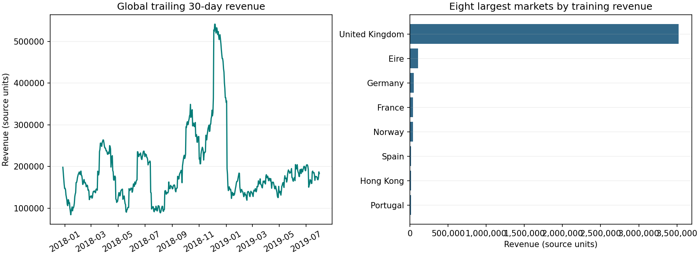
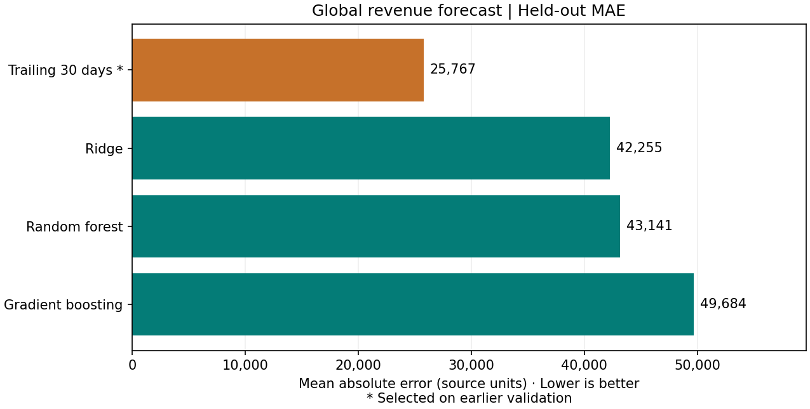
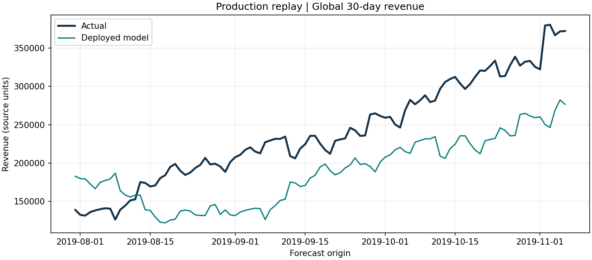

# AAVAIL 30-day revenue forecast

Forecast invoice revenue for the next 30 calendar days from an end-of-day forecast date. The Flask service accepts a named country or `all` for the global total. The repository contains the forecasting service, tests, monitoring scripts, charts and peer-review evidence.

## Peer-review checklist

| # | Review question | Evidence |
|---|---|---|
| 1 | API unit tests | [API tests](tests/test_api.py) exercise training, health, country and global predictions, log retrieval and invalid requests. |
| 2 | Model unit tests | [Model tests](tests/test_model.py) exercise feature cutoff, persistence, forecast horizon and candidate evaluation. |
| 3 | Logging unit tests | [Logging tests](tests/test_logging.py) verify round trips, read limits and concurrent writes. |
| 4 | Single test command, all tests pass | `bash scripts/run_tests.sh`. All 10 tests passed locally. |
| 5 | Performance monitoring | [Monitoring module](forecast/monitor.py) joins forecasts to mature actuals and reports MAE, RMSE, signed bias, WAPE, baseline MAE and p95 prediction latency. See the [replay results](reports/monitor_summary.csv). |
| 6 | Read/write test isolation | The [API](tests/test_api.py), [model](tests/test_model.py) and [logging](tests/test_logging.py) tests use temporary directories and generated fixtures. |
| 7 | Country and combined predictions | [HTTP smoke test](scripts/smoke.py) checks United Kingdom and `all` against the running service. Both calls passed locally with the course data. |
| 8 | Automatable ingestion | [Ingestion module](forecast/ingest.py) and [data script](scripts/fetch_data.sh) provide a function and command-line entry point. |
| 9 | Multiple models compared | [Holdout metrics](reports/holdout_metrics.csv) compare ridge regression, random forest, gradient boosting and a trailing-30-day baseline where the training scope has signal. |
| 10 | EDA visualizations | [EDA chart](reports/eda.png) shows revenue over time and the eight largest markets. |
| 11 | Docker packaging | [Dockerfile](Dockerfile) packages the API, data, trained model and tests. [GitHub Actions](.github/workflows/verify.yml) builds the image, runs its tests and checks its HTTP endpoints. Docker execution still needs verification on a Docker-enabled runner. |
| 12 | Visual model-to-baseline comparison | [Global holdout chart](reports/holdout_comparison.png) compares all three learned models with the baseline on the same forecast dates. |

## Run locally

Requires Python 3.12 and Git. The data script downloads the pinned revision of the [IBM capstone data repository](https://github.com/aavail/ai-workflow-capstone). It also accepts the path to a local checkout at the same revision. The raw invoices are fetched from that source.

```bash
python3.12 -m venv .venv
source .venv/bin/activate
python -m pip install -r requirements.txt
bash scripts/run_tests.sh
bash scripts/fetch_data.sh
python -m forecast.model data/train.csv runtime/model.joblib

TRAINING_DAILY_PATH=data/train.csv OBSERVED_DAILY_PATH=data/observed.csv \
  python -m gunicorn --bind 127.0.0.1:8000 --workers 1 --threads 4 'forecast.api:create_app()'
```

From a second terminal:

```bash
python scripts/smoke.py

curl -G http://127.0.0.1:8000/predict \
  --data-urlencode 'country=United Kingdom' --data-urlencode 'as_of=2019-07-31'

curl -G http://127.0.0.1:8000/predict \
  --data-urlencode 'country=all' --data-urlencode 'as_of=2019-07-31'

curl -X POST http://127.0.0.1:8000/train
curl http://127.0.0.1:8000/logfile
```

`/predict` also accepts a JSON object via POST. Dates are inclusive as-of dates. A forecast issued as of 31 July covers 1–30 August. An unknown country yields 404, a malformed date yields 400, and a date outside the model's supported history yields 422. The supplied model supports dates from its training cutoff on 31 July 2019 through the last available observed day, 6 December 2019. Country models and the global model are selected independently, so their forecasts can differ from a sum of individual country forecasts. The API is designed for a local reviewer environment. Restrict access to `/train` and `/logfile` before deploying it to a shared network.

## Run with Docker

First generate the daily CSVs with `bash scripts/fetch_data.sh` as described above. From the repository root:

```bash
docker build -t aavail-forecast .
docker run --rm aavail-forecast bash scripts/run_tests.sh
docker run --rm -p 127.0.0.1:8000:8000 aavail-forecast
```

Run `python scripts/smoke.py` from a second terminal. The image trains during build and runs the API as a non-root user.

## Data and evaluation

The training data contains 815,011 invoice rows across 21 files, with dates from 28 November 2017 to 31 July 2019. The production replay uses 252,359 rows from five separate files covering 1 August to 6 December 2019. The [audit](reports/ingestion_audit.json) records invalid rows, missing country labels and negative prices. Revenue is the sum of the source `price` or `total_price` field, including signed adjustments. Country labels are normalized, unknown geography remains in the global total, and calendar days with no rows are treated as zero recorded revenue. The EDA shows a pronounced late-2018 peak and a large concentration in the United Kingdom.



Models use revenue from the last 7, 14, 30, 60 and 90 days, plus a seasonal day-of-year encoding. The baseline uses the last 30 days of recorded revenue. For each country and the global total, model selection uses validation MAE. The fit and validation windows are separated from the next stage by requiring each label's 30-day outcome window to finish before the next stage starts. Weekly forecast dates provide nine final holdout comparisons per model. Those outcomes overlap within the holdout, so interpret the scores as a descriptive comparison.



| Global candidate | Validation MAE | Holdout MAE |
|---|---:|---:|
| Trailing 30 days, selected | 24,043 | 25,767 |
| Ridge | 95,259 | 42,255 |
| Random forest | 68,958 | 43,141 |
| Gradient boosting | 79,077 | 49,684 |

The trailing baseline won global and UK validation and remained best for both on holdout. For global forecasts, the lowest holdout error among learned models came from ridge, about 64% above the baseline. The validation winner for each scope is refit on all eligible training windows before deployment.

## Production replay and interpretation

`bash scripts/replay.sh` regenerates all charts and tables. It sends daily requests through Flask for the global total and the United Kingdom. Each forecast uses history only through its origin. The monitoring script scores only forecasts with all 30 outcome days observed. It uses a fresh, isolated database for each replay.



| Scope | Mature forecasts | MAE | WAPE | Signed bias |
|---|---:|---:|---:|---:|
| All countries | 99 | 60,503 | 25.17% | −51,959 |
| United Kingdom | 99 | 54,974 | 26.10% | −46,096 |

Negative bias means the service generally underpredicted revenue in this replay. The trailing baseline reacts slowly when revenue rises, which matters if operating plans use the forecast to set capacity. Before changing the deployed method, compare a seasonal baseline and calendar-aware features on several time-separated evaluation windows. WAPE divides total absolute forecast error by total absolute actual revenue. Scores are in source revenue units unless expressed as percentages, and the overlapping forecast windows share underlying revenue observations.

To run the same monitor on logs from your local API:

```bash
python -m forecast.monitor runtime/predictions.sqlite data/observed.csv runtime/monitoring
```

Source data and case context come from the [IBM AI Enterprise Workflow Capstone](https://github.com/aavail/ai-workflow-capstone/tree/fd6182c4458bccb56024047a1a85f506a90caf98). This repository contains an independent implementation.
